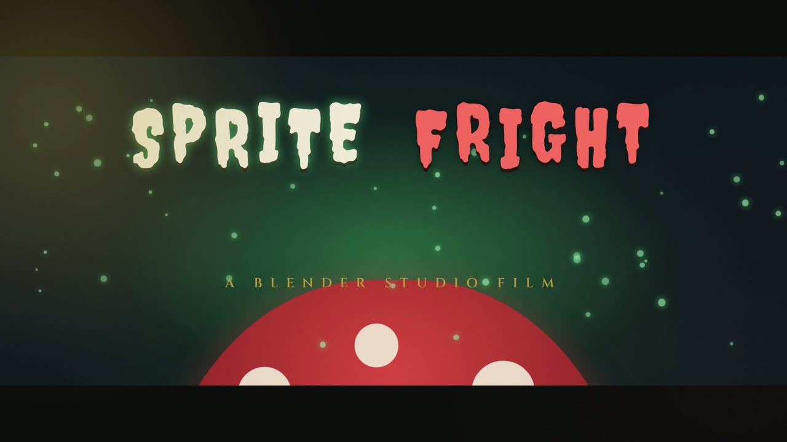
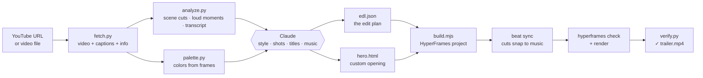

<div align="center">

# 🎬 yt-trailer

**Turn any YouTube video or video file into a short, animated trailer, made by Claude.**

A [Claude Code](https://claude.com/claude-code) skill that watches a video's structure, picks its best moments, writes the title cards, designs a custom opening, and renders a 30–60 second trailer with [HyperFrames](https://hyperframes.heygen.com).

[](examples/sprite-fright/trailer.mp4)

**[▶ Watch the sample trailer](examples/sprite-fright/trailer.mp4)** · made from Blender Studio's CC BY 4.0 short film *Sprite Fright*

</div>

---

## The idea

Cutting a trailer by hand means scrubbing through the whole video, finding the moments that land, writing copy, animating titles, picking music and lining the cuts up with the beat. That takes hours.

`yt-trailer` splits the job between scripts and Claude:

- **Scripts do the mechanical work.** They download the video, find scene cuts and loud moments, read the captions, sample the colors, check the edit and render it.
- **Claude does the creative work.** It decides what kind of trailer the video deserves, chooses the shots, writes the title cards and designs a one-off animated opening for that specific video.

The result is a trailer that looks designed rather than templated, because every one is cut, titled and colored for its source video.

## What you get

```
/yt-trailer https://www.youtube.com/watch?v=_cMxraX_5RE
```

Output: `trailer-<videoId>/trailer.mp4`, a 45-second 1080p trailer with:

- 🎞️ **Hand-picked shots**: 6–15 moments chosen from captions, scene cuts and audio peaks, without spoiling the ending
- ✍️ **Title cards** written from the video's real content, such as "THEY CAME TO CAMP" and "NOW THE FOREST FIGHTS BACK"
- ✨ **A custom hero opening** Claude animates for this video alone
- 🎵 **Music** (bundled, CC0) with **every cut snapped to the beat** and the music **ducked under dialogue**
- 🎨 **Colors pulled from the video itself**, so titles match the footage
- 🎥 **Finishing touches** chosen per style: letterbox bars, film grain, light leaks, RGB glitch hits, flash cuts, slow motion and speed ramps

## Three styles, chosen automatically

Claude reads the title, description, chapters and transcript and picks a style. You can force one with `--style`.

| Style | Best for | Feel |
|---|---|---|
| 🎭 **cinematic** | short films, documentaries, story vlogs, nature | Slow pushes, serif titles, letterbox, grain, a rising score |
| ⚡ **hype** | gaming, sports, action, music videos, travel montages | Kinetic slamming type, flash punches, speed ramps, glitch hits |
| 💬 **highlight** | talks, tutorials, podcasts, interviews, reviews | Clean lower-third captions, quote cards, chapter bumpers |

## How it works



1. **Fetch.** `yt-dlp` downloads the video at 720p, with captions when available (English first, then the video's own language).
2. **Analyze.** ffmpeg finds scene cuts and the loudest moments, and the captions become a clean, timed transcript. Everything is squeezed into a small `candidates.json` that Claude can read cheaply.
3. **Plan.** Claude writes `edl.json`, an *edit decision list*: style, shots, effects, title text, music. A validator checks every rule (lengths add up, clips exist in the source, 6–15 shots) before anything is built.
4. **Design.** Claude writes one custom animated opening scene for the video, following a strict [scene contract](skills/yt-trailer/references/scene-contract.md).
5. **Build.** The edit plan is assembled from a library of tested, animated scenes into a HyperFrames project.
6. **Sync.** The music's beats are detected and every cut moves to the nearest beat (within ±0.15 s).
7. **Check, render, verify.** HyperFrames audits the layout, motion and contrast and then renders. A final check confirms the MP4's length, size and audio.

If Claude's custom opening fails its checks twice, the skill swaps in a tested title scene and keeps going, so a run never dies on a creative experiment.

## Quick start

### 1. Install the requirements

| Requirement | Install (macOS) |
|---|---|
| [Claude Code](https://claude.com/claude-code) | see the link |
| Node.js 22+ | `brew install node` |
| Python 3.10+ | `brew install python` |
| ffmpeg | `brew install ffmpeg` |
| yt-dlp | `brew install yt-dlp` |
| HyperFrames agent skills | see [hyperframes.heygen.com](https://hyperframes.heygen.com) |

You don't have to check these yourself. The skill runs a doctor script first and prints the exact install command for anything missing, on macOS, Linux or Windows.

### 2. Install the skill

In Claude Code:

```
/plugin marketplace add amateurcoder015/claude-skill
/plugin install yt-trailer@yt-trailer
```

Or copy `skills/yt-trailer/` into `~/.claude/skills/`.

### 3. Make a trailer

```
/yt-trailer https://www.youtube.com/watch?v=VIDEO_ID
```

Or just ask in plain words:

> *"Make a hype teaser from https://youtu.be/VIDEO_ID, vertical, 30 seconds, for TikTok"*

## Usage

```
/yt-trailer <url | --file path> [options]
```

| Option | Default | What it does |
|---|---|---|
| `--style cinematic\|highlight\|hype` | chosen from the video | Force a style |
| `--vertical` | off | 1080×1920 for Shorts, Reels and TikTok |
| `--length 30\|45\|60` | 45 | Trailer length in seconds |
| `--music path` | bundled track when the style needs it | Use your own music |
| `--no-music` | off | Original audio only |
| `--file path` | none | Use a local video instead of a URL |
| `--cookies-from-browser name` | none | For age-restricted or blocked videos |
| `--draft` | off | Fast, lower-quality render for previews |

**Examples**

```bash
/yt-trailer https://youtu.be/VIDEO_ID --style hype --vertical --length 30
/yt-trailer --file ~/Movies/my-film.mp4 --music ~/Music/score.mp3
/yt-trailer https://www.youtube.com/watch?v=VIDEO_ID --draft      # quick preview first
```

## Tweak a trailer you've made

Every run leaves a working folder you can edit and re-render:

```
trailer-<videoId>/
├── source/            video.mp4, captions.vtt, info.json
├── candidates.json    what the analysis found
├── palette.json       colors from the video
├── edl.json           ← the edit plan: edit this
├── custom/hero.html   ← Claude's custom opening: edit this too
├── project/           the generated HyperFrames project
└── trailer.mp4        the result
```

Change a title, swap a shot, try another style or add slow motion in `edl.json`, then ask Claude to *"rebuild and render the trailer"*. A shot is just a time range in the source video:

```json
{ "type": "clip", "in": 303.4, "out": 305.4, "fx": ["flash-punch"] }
```

The full format is in [`schema/edl.schema.json`](skills/yt-trailer/schema/edl.schema.json), and [`references/edl-guide.md`](skills/yt-trailer/references/edl-guide.md) explains how Claude makes its choices.

<details>
<summary><b>Everything an edit plan can use</b></summary>

| Building block | Options |
|---|---|
| Title scenes | `cinematic/slow-push-title`, `cinematic/black-to-title`, `hype/kinetic-slam`, `highlight/quote-card`, `highlight/chapter-bumper` |
| End cards | one per style, added automatically |
| Clip effects | `slowmo`, `speed-ramp`, `flash-punch`, `push-in`, `zoom-in` |
| Clip extras | `caption` (animated lower third), `cropX` (framing for vertical) |
| Montage | 2–3 shots side by side (stacked when vertical) |
| Overlays | `letterbox`, `grain-lightleak`, `glitch-rgb` (flashes on every cut) |
| Custom | one `hero` scene written by Claude |

</details>

## The sample

[`examples/sprite-fright/`](examples/sprite-fright/) shows a full run on Blender Studio's short film *Sprite Fright* (10.5 minutes, CC BY 4.0):

- Claude chose **cinematic** for a narrative animated short.
- It built a story arc in 13 shots: campsite comedy → meeting the sprites → the night attack, stopping before the ending.
- It designed a mushroom-themed opening with rising glowing spores.
- Every cut sits on the beat of a 152 BPM score.

The folder includes the [edit plan](examples/sprite-fright/edl.json) and [custom opening](examples/sprite-fright/hero.html) Claude wrote, so you can see exactly what it decided.

## Good to know

- **Rendering takes a while.** HyperFrames captures every frame in a real browser. Without a GPU, expect roughly 1–2 seconds per frame (the 45-second sample took about 16 minutes on an 8-core Mac). Use `--draft` while experimenting.
- **Downloads can break.** YouTube changes often. If downloads fail, update with `yt-dlp -U`, then retry with `--cookies-from-browser chrome`.
- **Missing Chrome for rendering:** run `npx --yes hyperframes@0.8.104 browser ensure`.
- **Limits:** sources must be 15 seconds to 2 hours long.

## Use it responsibly

> Downloading videos from YouTube may violate YouTube's Terms of Service. Use this skill only on videos you own, Creative Commons videos, or videos you have permission to use. For anything else, use `--file` with a copy you have rights to. If the source license requires attribution (like CC BY), credit the original creator when you share the trailer.

## Repository layout

```
.
├── .claude-plugin/          plugin + marketplace manifests (what /plugin install reads)
├── skills/yt-trailer/       the skill itself
│   ├── SKILL.md             the workflow Claude follows
│   ├── scripts/             doctor, fetch, analyze, palette, build, verify
│   ├── scenes/              tested animated scenes (titles, end cards, overlays)
│   ├── references/          edit-plan guide and scene contract for Claude
│   ├── schema/              edl.json schema
│   └── assets/music/        six CC0 tracks, two per style
├── examples/sprite-fright/  sample trailer and the plan behind it
├── tests/                   Python, Node, scene render, end-to-end and trigger tests
└── docs/                    design spec, implementation plan, test results
```

## Development

```bash
python3 -m pip install pytest
python3 -m pytest          # download, analysis, palette, doctor and verify scripts
npm test                   # edit-plan validation, composition, beat sync, build
npm run test:scenes        # renders every scene through `hyperframes check` (slow)
npm run test:e2e           # offline end-to-end: builds and renders two full trailers (slow)
```

The runtime has no third-party dependencies beyond the tools above: Python uses only its standard library and Node only its built-ins. New title scenes follow the [scene contract](skills/yt-trailer/references/scene-contract.md) and are checked automatically by `npm test`.

## Credits and license

- **Code:** MIT, see [LICENSE](LICENSE).
- **Bundled music:** CC0 tracks from OpenGameArt, see [LICENSES-MUSIC.md](LICENSES-MUSIC.md).
- **Sample trailer:** made from *Sprite Fright* by Blender Studio (CC BY 4.0) and released under the same license.
- **Rendering:** [HyperFrames](https://hyperframes.heygen.com) by HeyGen. **Downloading:** [yt-dlp](https://github.com/yt-dlp/yt-dlp).
